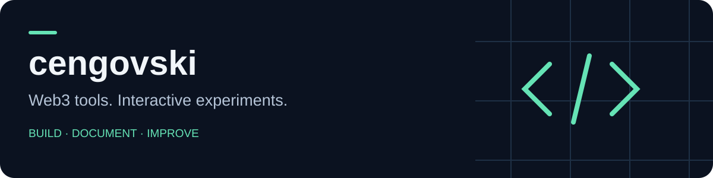

# Hi, I'm dzengo 👋

I build and experiment with Web3 interfaces, browser-based tools, and interactive applications. My public work includes market-data dashboards, testnet games, and developer workflows.

## Selected projects

| Project | What you'll find |
| --- | --- |
| [Binance Funding Rate Monitor](https://github.com/cengovski/Binance-Funding-Rate-Monitor) | A lightweight browser dashboard for funding-rate monitoring, recent history, and alerts. |
| [earlygem](https://github.com/cengovski/earlygem) | A TypeScript / Next.js radar for market activity across Solana and EVM networks. |
| [Arctic — Arc Testnet](https://github.com/cengovski/arctic-game-arc-testnet) | An experimental NFT game with React, wallet integration, and Solidity contracts. |
| [cursor-guard](https://github.com/cengovski/cursor-guard) | Reusable rules, skills, and workspace conventions for focused development. |

## What I'm working with

- **Interfaces:** TypeScript, JavaScript, React, Next.js, HTML / CSS.
- **Web3 experiments:** Solidity, EVM wallets, on-chain data, and testnet applications.
- **Operations:** Linux services, deployment workflows, and clearer project documentation.

## Collaboration

For a bug or idea, open an issue in the relevant repository with reproduction steps and the expected result. Small, focused pull requests are welcome; describe what changed and how you checked it.

These repositories include experiments and prototypes. Check each project's README and network configuration before running it; test tokens and displayed market data do not promise financial returns.

---

[Explore my repositories](https://github.com/cengovski?tab=repositories)
